# Valheim mods by koendertjh

Small quality-of-life mods for **Valheim 1.0** that help you keep track of what you have built, crafted,
unlocked and collected, help you get every achievement, and smooth out a few rough edges. Every mod runs on your own game and works on vanilla servers. Other players don't
need them, except EssenceForAll, which works best when the whole group has it.

## The mods

| | Mod | What it does | |
| --- | --- | --- | --- |
|  | **AchievementPeek** | Going for every achievement? See the foods, creatures, fish and deaths you're still missing instead of ???, and reveal secret achievements one boss at a time. | [Download](https://thunderstore.io/c/valheim/p/koendertjh/AchievementPeek/) · [Details](AchievementPeek/README.md) |
| 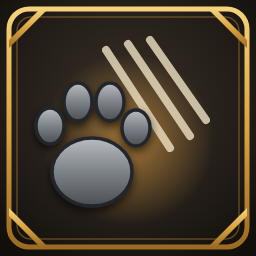 | **BestiaryTracker** | Creatures you have never slain show *(not slain)* above their health bar, and every new kind you slay counts toward The Hunter. | [Download](https://thunderstore.io/c/valheim/p/koendertjh/BestiaryTracker/) · [Details](BestiaryTracker/README.md) |
| 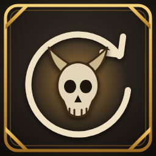 | **BossReset** | A boss fight gone wrong? `/bossreset` removes the boss and its minions and gives back your summoning items, so you can start over. | [Download](https://thunderstore.io/c/valheim/p/koendertjh/BossReset/) · [Details](BossReset/README.md) |
| 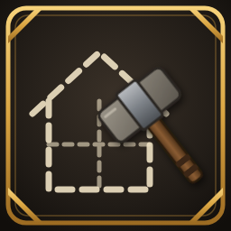 | **BuildTracker** | Adds a **Not built** tab to the build menu with every piece you have never placed, and shows how many pieces you haven't discovered yet. | [Download](https://thunderstore.io/c/valheim/p/koendertjh/BuildTracker/) · [Details](BuildTracker/README.md) |
| 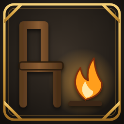 | **ComfortHelper** | A Comfort tab in the build menu with check marks on what already counts nearby, and tips on what would raise your comfort, on the way to comfort level 20. | [Download](https://thunderstore.io/c/valheim/p/koendertjh/ComfortHelper/) · [Details](ComfortHelper/README.md) |
| 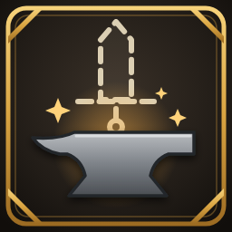 | **CraftTracker** | Adds a **Not crafted** tab to crafting stations with every item you have never made. You can craft straight from it. | [Download](https://thunderstore.io/c/valheim/p/koendertjh/CraftTracker/) · [Details](CraftTracker/README.md) |
| 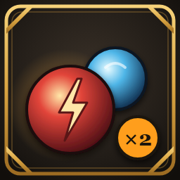 | **EssenceForAll** | Thunderblood and Frostfire essences always drop, with one share for every player that was nearby when the creature spawned. | [Download](https://thunderstore.io/c/valheim/p/koendertjh/EssenceForAll/) · [Details](EssenceForAll/README.md) |
| 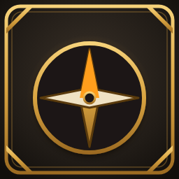 | **ExploreHelper** | Pins the four far edges of the world on your map and tells you when you reach one, for The Explorer and The Pathfinder. | [Download](https://thunderstore.io/c/valheim/p/koendertjh/ExploreHelper/) · [Details](ExploreHelper/README.md) |
| 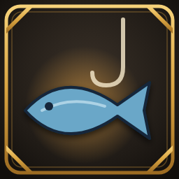 | **FishTracker** | See which fish you haven't caught and which bait they take, and mash bait into chum to lure the fish of a biome right to you. | [Download](https://thunderstore.io/c/valheim/p/koendertjh/FishTracker/) · [Details](FishTracker/README.md) |
| 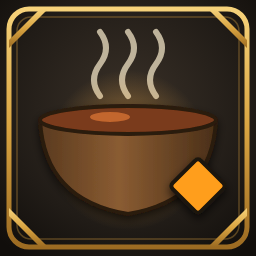 | **FoodTracker** | Food you have never eaten or cooked is marked in tooltips and in your inventory, with your progress for The Gourmet and The Master Chef. | [Download](https://thunderstore.io/c/valheim/p/koendertjh/FoodTracker/) · [Details](FoodTracker/README.md) |
| 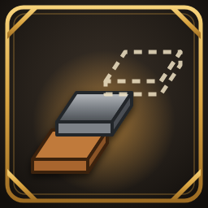 | **MaterialTracker** | A Materials window next to Trophies with every crafting material: the ones you have found, and where to find the rest, revealed one boss at a time. | [Download](https://thunderstore.io/c/valheim/p/koendertjh/MaterialTracker/) · [Details](MaterialTracker/README.md) |
|  | **MerchantTracker** | Marks the wares of Haldor, Hildir and the Bog Witch you have never owned, and counts the wares they will only sell later. | [Download](https://thunderstore.io/c/valheim/p/koendertjh/MerchantTracker/) · [Details](MerchantTracker/README.md) |
|  | **ModdedAchievements** | Earn achievements in a modded game. Only the "modded" mark is ignored: real cheating still blocks them. | [Download](https://thunderstore.io/c/valheim/p/koendertjh/ModdedAchievements/) · [Details](ModdedAchievements/README.md) |
| 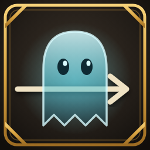 | **SummonTweaks** | Walk straight through your summoned skeletons and spirits, and the Spirit Caller always summons a spirit you don't have yet. | [Download](https://thunderstore.io/c/valheim/p/koendertjh/SummonTweaks/) · [Details](SummonTweaks/README.md) |
| 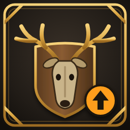 | **TrophyAssister** | No more endless grinding for one trophy: every kill without a drop makes the next one more likely. The Trophies tab shows your chances and the trophies you are still missing. | [Download](https://thunderstore.io/c/valheim/p/koendertjh/TrophyAssister/) · [Details](TrophyAssister/README.md) |
| 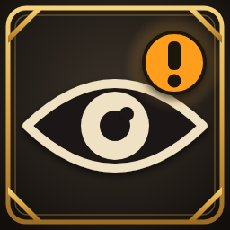 | **UnlockAwareness** | Puts a **!** on every new recipe, build piece and first-time item until you have looked at it, so new unlocks never go unnoticed. | [Download](https://thunderstore.io/c/valheim/p/koendertjh/UnlockAwareness/) · [Details](UnlockAwareness/README.md) |
| 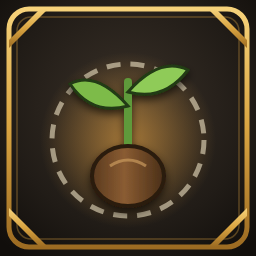 | **WorldSeed** | Shows the world seed on the big map and with `/seed`, also on servers. Optionally secret until you defeat a boss. | [Download](https://thunderstore.io/c/valheim/p/koendertjh/WorldSeed/) · [Details](WorldSeed/README.md) |

The mods work fine on their own, and also together.

## How to install

**With a mod manager (easiest):** in [r2modman](https://thunderstore.io/c/valheim/p/ebkr/r2modman/) or the
Thunderstore app, pick Valheim, search for **koendertjh** and click install. BepInEx is installed for you.

**By hand:**
1. Install [BepInExPack for Valheim](https://thunderstore.io/c/valheim/p/denikson/BepInExPack_Valheim/)
   (follow the steps on its page).
2. Download a mod with the **Download** link above (the *Manual Download* button on Thunderstore) and unzip it.
3. Copy the `.dll` file into `Valheim\BepInEx\plugins\`.

Settings appear in `BepInEx\config\` after starting the game once with the mod. Each mod's
**Details** page explains its settings.

## Questions and bugs

Found a bug or have an idea? Open an [issue](https://github.com/Koen-H/valheim-mods/issues). Please mention
which mod and version you use, and attach `BepInEx\LogOutput.log` if something went wrong.

## About

These mods are made with the help of AI (Claude).
Building them yourself or want to help out? See [CONTRIBUTING.md](CONTRIBUTING.md).

Licensed under [MIT](LICENSE): you are free to learn from, change and reuse the code.
